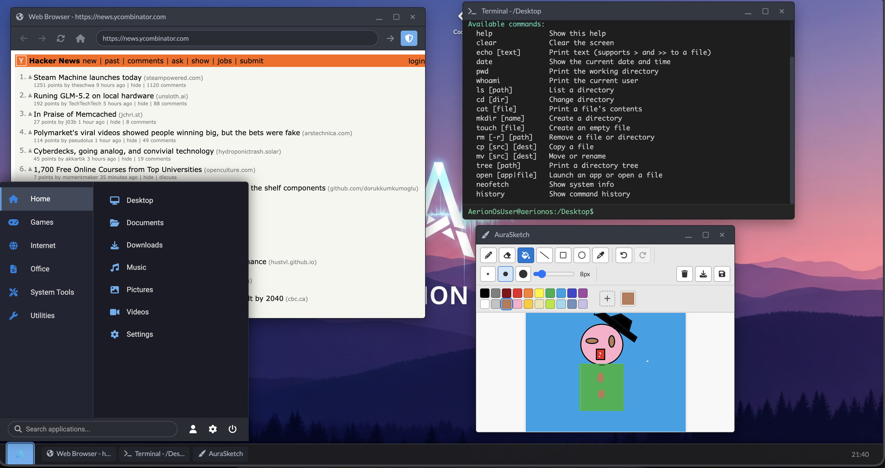

# AerionOS - Web OS Simulator (Beta)

AerionOS is an interactive desktop operating system simulation that runs entirely in your browser, built with **HTML, CSS and JavaScript (ES6+ Modules)**. This project, currently in **Beta**, serves as a portfolio piece to showcase the creation of complex interfaces and modular web applications.

## Highlights

*   **Desktop Environment:** Draggable, minimizable, maximizable and closable windows.
*   **Multiple Windows per App:** Open several instances of the same app at once, each with fully isolated state.
*   **Taskbar and Start Menu:** Functional for launching applications and managing windows.
*   **Simulated File System:** Persisted per user using `localStorage`.
*   **Login Screen:** A passwordless default-user login screen is shown before the desktop; logging out returns to it.
*   **Included Applications:**
    *   File Explorer
    *   Notepad (create, open and save `.txt` files)
    *   Code Editor (syntax highlighting, open/save files, run HTML in a preview window)
    *   Terminal (file system commands — `ls`, `cd`, `cat`, `mkdir`, `touch`, `rm`, `cp`, `mv`, `tree`, `open`, `neofetch`, `history`, `echo` with `>`/`>>` redirection; colored output, command history and tab completion)
    *   Calculator
    *   Web Browser (fetches sites through a CORS proxy; includes a start page, a stop button and cancellable navigation — limited by the X-Frame-Options/CORS policies of many sites)
    *   Settings (wallpaper customization, system info)
    *   AuraSketch (drawing app: pencil, eraser, paint bucket, line/rectangle/ellipse shapes, color palette, eyedropper, undo/redo, brush sizes, download as PNG and save into the file system)
    *   Games: Minesweeper (first click is always safe), Chess (1P vs AI / 2P local, with check and checkmate detection) and **DOOM** (full DOSBox emulation of the classic game)
*   **Modular Architecture:** Code organized into ES6 classes and modules.

## Recent Improvements

*   **Login Screen:** Passwordless login with a default user, shown before the desktop.
*   **AuraSketch Upgrade:** Paint bucket, shape tools, color palette, eyedropper, undo/redo and save (PNG download + file system).
*   **Terminal Upgrade:** Many new file commands, colored output, redirection and tab completion of commands.
*   **DOOM Keyboard Fix:** DOSBox no longer hijacks the keyboard after closing or when other apps are focused.
*   **Browser Navigation:** Loads are now cancellable (stop button, start page) so the UI never gets stuck while a page is loading.
*   **Per-Window State:** Multi-instance apps no longer share state between windows.
*   **English Codebase:** The whole codebase and UI were translated to English.

## Technologies

*   HTML5, CSS3 (Variables, Flexbox, Grid)
*   JavaScript (ES6+ Classes and Modules)
*   Font Awesome (Icons)
*   `localStorage` (Persistence)

## Running

1.  Download or clone the project.
2.  **Serve the files through a local web server.** (e.g. VSCode "Live Server" extension, or `npx http-server` in the project folder).
    *   *Opening `index.html` directly from the file system (`file:///`) will not work because of the ES6 modules.*
3.  Open your local server URL (e.g. `http://localhost:8080`) in a modern browser.

## Live Demo

You can try the demo at the following link:

[https://juansesdev.github.io/AerionOS/](https://juansesdev.github.io/AerionOS/)

## Author

*   **JuansesDev**
    *   GitHub: [@JuansesDev](https://github.com/JuansesDev)
    *   Web Portfolio: [juanses-dev.com](https://juanses-dev.com)
    *   LinkedIn: [Sebastián Vargas](https://www.linkedin.com/in/sebastian-vargas-122aa4285)

*(This project is under active development. Feedback and suggestions are welcome!)*
